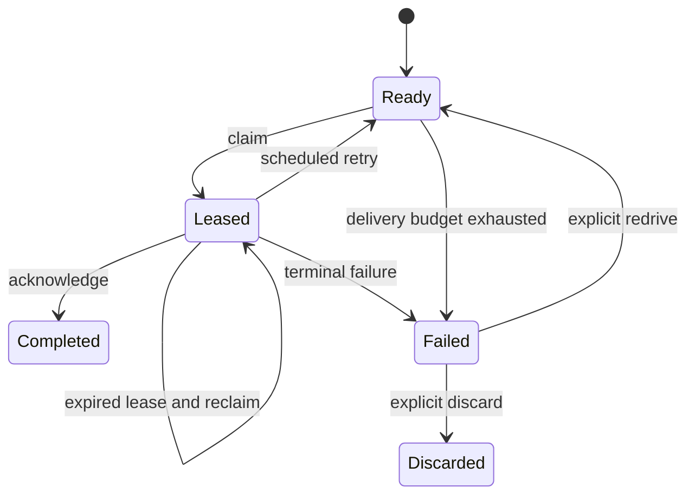

# Cycle / PostgreSQL transport profile

This document specifies the first persistent implementation of the contracts in
[the library specification](specification.md). Requirements are normative; [implementation evidence](implementation.md) records
which conformance experiments have actually run. **MUST** and **MUST NOT** identify
acceptance requirements for this profile.

## 1. Scope and dependencies

The adapter package is `componenta/queue-cycle`. It requires PHP `^8.5.13`,
`cycle/database ^2.24` directly, and the matching `componenta/queue` contracts.
Its first conformance target is **PostgreSQL 16 and later supported versions**.
Cycle's other drivers do not establish MySQL or SQLite support. Each additional
database requires its own concurrency design and conformance run.

The adapter uses the database write connection for publication, reservations,
settlement, renewal, failure management, and authoritative reads. Replica reads
cannot establish current ownership or the result of an earlier write. The initial tables are `queue_messages` and `queue_failures` in the configured
database schema; schema selection is trusted installation configuration, never
a value derived from message headers.

Core methods retain their transport-independent signatures:

- `PublisherInterface::publish(Message $message, int $delayMilliseconds = 0): void`;
- `ReceiverInterface::receive(int $waitMilliseconds = 0): ?DeliveryInterface`;
- delivery accessors `raw()` and `metadata()`, and operations `acknowledge()`,
  `retry(int $delayMilliseconds)`, `fail(FailureDetails $failure)`, and `lease()`;
- `LeaseInterface::renew(int $leaseMilliseconds): LeaseSnapshot`.

The receiver and failure store are bound to a configured destination. A caller
cannot supply an unrelated queue name with a receipt. The core worker performs
one processing operation; the console integration owns repetition, signals, and
elapsed-runtime limits.

## 2. Identities, bytes, and counters

Three identities MUST remain distinct: the logical message ID, an internal row
ID, and the token identifying one reservation. Logical IDs are scoped by queue
for publication deduplication. Every committed reservation receives a fresh,
unguessable token. Redrive starts a new processing generation without replacing
the logical ID. Provider tokens and database handles remain private.

The original `RawMessage` consists of body bytes and string headers. The adapter
MUST preserve them without PHP object serialization, lossy JSON conversion, or
text-encoding repair. Message decoding happens after delivery acquisition;
malformed envelopes can therefore be moved to failure storage with their exact
raw content. Storage identity does not depend on successfully decoding the body.

Within a processing generation:

- `deliveryCount` starts at zero and increases once per committed reservation,
  including reservations followed by a crash before handler execution;
- `retryCount` starts at zero and increases only when an explicit durable retry
  transition commits. Lease recovery does not increase it.

Neither counter represents completed business effects. Lifetime delivery and
redrive counts survive new processing generations. Counter overflow MUST fail
without wrapping or modifying the record.

## 3. Transaction and time ownership

Ordinary publication, receive, settlement, renewal, and failure-store mutations
MUST use short transactions on the write connection. They MUST reject an already
active foreign transaction, or use an independently configured connection.
Committing a nested savepoint is insufficient. No handler, external HTTP call, or
user callback executes inside these transport transactions.

`TransactionalPublisher::stage()` is the explicit exception described below.
The adapter MUST NOT silently switch ordinary publication to staging semantics.
Cycle documents transaction management and reconnect behavior; implementation
must verify the actual driver and connection used, not just a database alias.[1]

PostgreSQL time is authoritative for eligibility and ownership. Store instants
as `timestamptz` with microsecond precision. Round-trips MUST preserve the instant
and microseconds, without a floating-point epoch conversion. Durations are integer
milliseconds. Reject negative values, unsupported ranges, and timestamp or
arithmetic overflow; do not clamp or round silently.

Adapter-owned transactions use transaction-local `DateStyle = 'ISO, YMD'` so
timestamp reads remain unambiguous under other session defaults. Commit and
rollback restore the caller's setting; transactional staging preserves it.

PSR-20 clocks may create application message timestamps. Worker elapsed-time
limits use a monotonic process clock. Neither replaces database time for leases.
`CURRENT_TIMESTAMP` and `now()` identify transaction start in PostgreSQL;
`clock_timestamp()` supplies current wall time.[2] For each guarded operation,
capture one database instant after acquiring the relevant row lock and use that
same instant for its comparisons and resulting timestamps.

## 4. Publication and deduplication

Ordinary `publish()` encodes and validates the message before opening its write
transaction. Success means the insertion, its immutable comparison record, and
any initial queue state were committed under this profile. It does not mean the
handler ran. Initial availability is database publication time plus the requested
delay. The logical ID belongs to the caller's message and is not regenerated on
a transport retry.

A unique constraint on `(queue, logical_message_id)` arbitrates concurrent
publications. This profile accepts queue names up to 128 UTF-8 bytes and logical
IDs up to 255 UTF-8 bytes, both non-empty and without control characters. These
are explicit adapter design limits, not PostgreSQL or core-format requirements.
Validate them before SQL and enforce the byte lengths with `octet_length` schema
constraints. Store both keys as `text COLLATE "C"` with deterministic byte-exact
equality; do not use a nondeterministic or case-insensitive collation. The initial
profile requires a standard PostgreSQL block size of at least 8 KiB, checked at
adapter initialization, so the bounded combined key fits its B-tree index.
Require `server_encoding = UTF8` and `client_encoding = UTF8` so valid core IDs
are representable and byte-length/equality rules have the same meaning.
An oversized logical ID raises `InvalidMessageException` before publication;
an invalid configured queue name fails adapter configuration before connection.
An existing entry is compared with the original body bytes,
original raw string headers in deterministic key order, and the **original
requested publication delay**. Header names and values are compared exactly as
defined by the core header contract; the adapter performs no extra case folding
or normalization. Map insertion order is irrelevant. Different body bytes remain
different even if an application considers their JSON meanings equivalent.

The stored comparison encoding MUST be unambiguous, including byte lengths.
A digest may accelerate comparison but MUST NOT replace exact comparison. The
canonical original is immutable: retry headers, receipt metadata, current
availability, generated storage timestamps, and redrive parameters do not alter
it. An equal publication is a no-op in every retained state, including failed and
completed. A mismatch is a conflict, never an overwrite or a new processing run.

Deduplication retention is mandatory configuration: choose a finite documented
duration or explicit indefinite retention. There is no arbitrary default.
Its terminal retention clock starts on successful acknowledgement or explicit
discard. Active entries and unresolved failures MUST NOT be removed merely
because a duration since first publication elapsed. After terminal retention
expires and cleanup actually deletes the comparison record, a late resend can
be accepted as a new publication. This is the precise boundary of the promise.
That new publication receives a new internal ledger incarnation. Internal IDs
are never reused; historical failure references MUST NOT be rebound merely
because queue and logical ID match a later incarnation.

## 5. Reservation and recovery

`receive(0)` performs one nonwaiting eligibility attempt, subject to configured
finite database-operation timeouts. A positive wait permits bounded polling;
the adapter MUST NOT hold a transaction or row lock between polls. A null result
means no delivery was returned, not that no eligible record existed or the queue
contains no records. The poll may have completed bounded exhausted-delivery
maintenance. Database failure is an error, not an empty result.

Use `FOR UPDATE SKIP LOCKED` on the authoritative ledger row to reserve eligible
ready records and recover expired reservations. PostgreSQL explicitly identifies queue-like tables as a use case,
but skipping locks does not provide a consistent global ordering and does not
avoid all table-level locks.[3] This profile consequently promises no strict FIFO.

The reservation protocol is pseudocode, not executable SQL:

```text
begin on the write connection
lock an eligible row, skipping rows another transaction locked
capture dbNow after obtaining the lock
recheck state and eligibility against dbNow
if the generation's delivery budget is exhausted:
    atomically record failure and remove active eligibility
else:
    replace reservation token
    increase generation and lifetime delivery counters
    mark leased; set leaseUntil = dbNow + configured lease duration
commit
return delivery only if the reservation commit is known to have succeeded
```

Eligibility means ready with `available_at <= dbNow`, or leased with
`lease_until <= dbNow`. Every adapter instance requires a positive `maxDeliveries`
configuration, recorded for the processing generation. The initial reservation
is delivery one. On the next eligible claim after the budget is exhausted, the
adapter MUST atomically create a failure record instead of issuing another
delivery. Merely excluding exhausted rows would leave immortal poison records
and is prohibited. An exhausted-row sweep is bounded per receive operation so
that it cannot defeat wait or shutdown limits.
This delivery budget may terminate work before the retry-policy budget; a saved
retry is eligibility for another run, not a promise that a further handler call
will bypass the delivery limit.

Commit MUST precede handler invocation. If the reservation commit outcome is
indeterminate, the adapter MUST NOT run the handler from that speculative result.
The committed lease, if any, is recovered through the normal expiry path.

## 6. Strict expiry and fenced transitions

This profile adopts **strict expiry**. A reservation loses authority when its
lease expires, even if another worker has not reclaimed the row. Settlement and
renewal first lock the row, then obtain database time. The complete guard is:

```text
configured queue matches
AND row identity matches
AND reservation token matches
AND state is leased
AND leaseUntil > dbNow
```

Equality means expired. A PHP-side check before the database call is insufficient.
Checking transaction-start time after a lock wait is also insufficient. The
linearization point is the guarded decision after lock acquisition; the lock
prevents a concurrent reclaim until that transaction completes. PostgreSQL keeps
row locks until transaction end and rechecks updated rows under Read Committed
rules.[4][5] Conformance must exercise waiting-lock cases explicitly.

An unmatched guard reports lost delivery authority without changing the row.
No operation with an old token may acknowledge, reschedule, fail, or renew a
new reservation. A successful transition becomes observable only after commit.

The following state diagram describes durable ledger state, not the local
delivery capability states in the core specification. Ready work can have a
future availability time; elapsed lease recovery issues a fresh token.



An exhausted expired lease also transitions directly from Leased to Failed.
Completed and Discarded retain deduplication state until configured cleanup.

| Operation | Atomic database effect |
|---|---|
| Acknowledge | Remove active eligibility; retain the immutable publication tombstone and start terminal retention. |
| Retry | Return to ready; set availability to guarded `dbNow + delay`; increase `retryCount`; invalidate the token. |
| Fail | Persist raw content and bounded failure details; remove active eligibility; invalidate the token. |
| Renew | Keep the same reservation; set expiry to guarded `dbNow + leaseMilliseconds`; return that committed expiry. |

Renewal duration MUST be positive. Renewal replaces the remaining duration from
the guarded instant; it does not add to the previous expiry. It cannot revive an
expired lease. Renewal is cooperative: callers must invoke it before expiry.
The adapter cannot guarantee periodic renewal while arbitrary synchronous PHP
code is blocked. Database calls from signal handlers are not an implementation
strategy for this profile.

There is no core release operation. Graceful draining completes the current
delivery before stopping. A crash leaves it recoverable after expiry. Fencing
protects queue state; it does not stop an old handler's code or reverse its
external effects. Applications still require idempotent effects.

## 7. Failures, redrive, and discard

`FailureStore` exposes `find`, bounded `page`, `redrive`, and `discard` for its
configured queue. Failure IDs and pagination cursors are opaque. Pages use a
stable unique ordering, bounded limits, and a documented continuation rule;
they are not a transactionally frozen snapshot of a changing failure store.

A failure record retains the delivered raw bytes and headers, logical message
ID, processing generation, both counters, failure time, and bounded diagnostic
details. Saving it and removing active eligibility MUST commit together. Failure
storage failure therefore cannot cause acknowledgement of the original message.
Invalid envelope failures require no successful message decode.

`redrive(failureId, delayMilliseconds)` is an explicit operator operation. It
first resolves the immutable ledger incarnation without locking, then locks the
ledger followed by the failure row and revalidates both. The failure must still
be pending and refer to that incarnation; the ledger must be failed and its
current failure ID and generation must match. It creates one new processing
generation, preserves raw content and logical ID, resets generation counters to
zero, increments lifetime redrive count, and records the chosen delay. The new
run takes its delivery budget from current explicit adapter configuration.
These changes commit atomically. Redrive is an internal transition, not a new
call to ordinary publication with a changed delay.

Repeating redrive for the same failure with the same delay is a no-op, including
after the new run finishes or fails again. A different delay conflicts. Replaying
an older failure never resurrects a later completed or discarded run. A discarded
failure cannot be redriven. Discard after redrive reports that the failure was
already redriven and MUST NOT cancel its resulting run. Repeated discard of an
already discarded failure is a no-op.

Discard removes the unresolved failure's eligibility for redrive, records an
audit transition, and starts terminal deduplication retention. It does not erase
history immediately. Automatic retry or automatic redrive of failed records is
outside this profile.

Failure/redrive/discard history has its own explicit retention configuration.
Cleanup must preserve unresolved failures and any references needed by active
runs. After a resolved failure record is cleaned, its ID returns not found;
neither redrive nor discard may reconstruct a run from that missing record.
Consequently the replayable no-op guarantee lasts while the history record is
retained; cleanup never turns an old failure ID into permission to reenqueue.
Publication and history cleanup lock the relevant ledger record before failure
records so that cleanup, late publication, and redrive cannot race past uniqueness checks.
Resolved history may retain immutable identity snapshots after its old ledger
reference is detached during cleanup. It must never point to a replacement
ledger incarnation or prevent the configured terminal cleanup indefinitely.

If the ledger disappeared after redrive's preliminary lookup, lock and re-read
the failure record. Only an already resolved historical no-op or conflict is
permitted; a pending failure without its ledger is a storage integrity error.
Never reconstruct a ledger from that historical lookup. A detached resolved
failure may be locked alone, but that path must not subsequently lock a ledger.

## 8. State ownership, storage layout and access paths

The initial profile has two tables. One ledger row owns all mutable state of a
logical publication; there is no separate active-delivery row requiring an
additional ownership lock. These shapes define ownership, not migration syntax:

| Table | Principal content and constraints |
|---|---|
| Message ledger | Unique queue plus logical ID; immutable row/incarnation ID; original raw body/header comparison bytes; original delay; current generation and failure ID; state ready/leased/failed/completed/discarded; availability; lease token/expiry; generation and lifetime counters; positive delivery budget; terminal-retention timestamps. One current run per ledger entry. |
| Failures | Unique failure ID; ledger/generation reference; preserved raw snapshot; diagnostics; counters; unresolved/redriven/discarded status; redrive parameters/result generation; retention timestamps. |

Use binary storage for body and canonical header bytes. A decoded JSON view may
be additional diagnostic data, not the preservation authority. Enforce valid
state/lease combinations and nonnegative counters with database constraints.

Provide queue-prefixed indexes for ready availability, expired leases, and
failure pagination. Partial indexes separate ready and leased access paths;
predicates use stable states, not volatile current-time expressions. Add explicit
terminal-retention indexes for bounded cleanup. Benchmark ready/expired selection
with realistic backlogs before choosing a combined query or two access paths.
All multirow mutations use one physical write connection and the lock order
**ledger, then failure rows in stable failure-ID order**. Cleanup atomically
detaches retained resolved history before deleting a terminal ledger; cascading
deletion of that retained history is prohibited. Pending failures cannot be
detached. Claim locks only the ledger until it needs to record an exhausted-budget
failure. Retrying deadlock-aborted transport transactions must never rerun handlers.

## 9. Staging, outbox, and outcome handling

`TransactionalPublisher::stage()` requires an active application-owned transaction
on the same physical write connection as the business changes. It validates and
stages the publication and comparison record, never commits, and returns no
claim of durable acceptance. Application rollback removes both. This is enough
for an atomic local database enqueue; an extra outbox table is unnecessary solely
to duplicate the same transaction boundary.
Its delay is anchored to the database staging instant, not a predicted commit
time. A long application transaction may consume that delay before commit; the
record remains invisible to other workers until commit regardless. Applications
requiring a full delay after commit need a different explicitly designed API.

A future external broker needs a separate outbox relay when publication must
follow a business commit. Publishing before marking an outbox row sent allows
duplicates after crashes; the reverse ordering can lose work. AWS's outbox
guidance explicitly identifies duplicate delivery and idempotent consumers.[6]
An inbox marker protects local effects only when the marker and those effects
share a transaction. It does not make an external payment or email atomic.

Errors distinguish **NotApplied**, **Indeterminate**, and lost delivery authority.
A connection failure around commit may be indeterminate. The adapter must not
guess rollback, return success, execute an opposite disposition, or rerun a
handler. Durable idempotent publication allows callers to retry the same original
message within its retention horizon. Settlement recovery uses current storage
state and lease recovery rather than that publication rule.

## 10. Conformance gates

Pest integration tests MUST use independent PostgreSQL write connections and
controlled concurrency. Required scenarios include competing claims, skipped
locked rows, reservation rollback, commit-before-handler, crash recovery,
exhausted-budget quarantine, all stale-token transitions, strict expiry after a
lock wait, renewal at the boundary, atomic retry/failure rollback, indeterminate
commit, simultaneous duplicate publication, exact-byte conflicts, transactional
staging rollback, concurrent redrive, conflicting redrive parameters, and cleanup
racing publication or redrive. SQLite and mocked SQL cannot establish these
properties. Run the shared transport contract suite as well as this stronger
profile. No production-readiness claim precedes these checks.

## Sources

1. [Cycle Database: transactions](https://cycle-orm.dev/docs/database-transactions/current/en).
2. [PostgreSQL 16: date/time functions](https://www.postgresql.org/docs/16/functions-datetime.html#FUNCTIONS-DATETIME-CURRENT).
3. [PostgreSQL 16: SELECT locking clauses](https://www.postgresql.org/docs/16/sql-select.html#SQL-FOR-UPDATE-SHARE).
4. [PostgreSQL 16: explicit locking](https://www.postgresql.org/docs/16/explicit-locking.html#LOCKING-ROWS).
5. [PostgreSQL 16: Read Committed isolation](https://www.postgresql.org/docs/16/transaction-iso.html#XACT-READ-COMMITTED).
6. [AWS: transactional outbox pattern](https://docs.aws.amazon.com/prescriptive-guidance/latest/cloud-design-patterns/transactional-outbox.html).
7. [PostgreSQL 16: B-tree index entry limits](https://www.postgresql.org/docs/16/btree-intro.html).
8. [PostgreSQL 16: deterministic and nondeterministic collations](https://www.postgresql.org/docs/16/sql-createcollation.html).

These sources establish platform behavior. Profile-specific requirements,
retention rules, API boundaries, and acceptance gates are Componenta design
decisions rather than requirements imposed by those external specifications.
